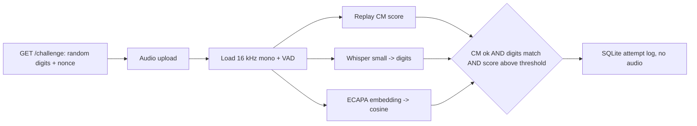

# Voice-biometric access control: implementation plan

Engineering thesis. Python 3.11, macOS Apple Silicon (M1), CPU only.

This plan contains no metric values. Every number reported in the thesis must come from executed code and be stored under `results/`.

## 1. Decisions

- **Speaker verification data:** VoxCeleb1 test set scored with the official cleaned VoxCeleb1-O trial list. The pretrained SpeechBrain ECAPA-TDNN model was trained on VoxCeleb1 dev and VoxCeleb2, so VoxCeleb1 test is a fair, speaker-disjoint evaluation set.
- **UBM training data:** the GMM-UBM needs non-target background speech. The source is set by `gmm.ubm_source` in `config.yaml`.
  - Preferred: a subset of VoxCeleb1 dev. It is in-domain, which keeps the comparison with ECAPA fair.
  - Fallback: LibriSpeech train-clean-100. If used, the domain mismatch must be stated in the thesis.
  - **Current choice: LIBRISPEECH FALLBACK** (`gmm.ubm_source: librispeech_train_clean_100`, `data/librispeech/LibriSpeech/train-clean-100`). Read, close-talk English audiobook speech vs. noisy, multi-channel, in-the-wild VoxCeleb1 test speech: a **domain mismatch** that disadvantages the GMM-UBM baseline relative to ECAPA. State this in the thesis.
- **Own corpus:** Polish speakers, at least 2 sessions recorded on different days. Each session contains free speech (enrollment) and random digit strings (text-dependent tests). Every speaker signs a consent form. Speaker IDs are pseudonymized.
  - Current state: one speaker (`spk01`, several sessions). More speakers may be added later.
  - All own-corpus code works for any number of speakers. With at least `own_corpus.min_speakers_disjoint` speakers (3, planned config key), splits are speaker-disjoint. Below that, the **single-speaker setup** applies: dev/eval split by session, and impostor trials come from public-data speakers. The chosen mode is written to `metrics.json` (`split_mode: speaker_disjoint | single_speaker`, plus the speaker count).
- **Staging:** own recordings come later. Every stage is completable now with code, unit tests and public data. The own-corpus run is a separate final step of each stage that uses it.
- **Multi-speaker digit data (stage 4):** Mozilla Common Voice Single Word Target Segment, Polish, digits 0-9 only, stored in `data/raw/common_voice_sw/` (manual download, gitignored). License CC0, but the dataset terms forbid attempting to identify speakers and re-sharing the data; only derived metrics and embeddings stay in the project, never clips or speaker IDs mapped to anything else.
- **Replay corpus (stage 5):** bona fide = live own recordings; replay = the same recordings played back through several devices (phone, laptop, Bluetooth speaker) at several distances and re-recorded with the system microphone. Device and distance are stored in the manifest.
  - Optional cross-domain variant: train the countermeasure on ASVspoof 2019 PA and test it on the own recordings.
- **ASR:** `openai-whisper`, model `small`, on CPU, language `pl`. Model name and language are set in `config.yaml`.
- **Threshold policy:** thresholds are always selected on a dev split and reported on a separate eval split. Dev and eval never share speakers, except in the own-corpus single-speaker setup, where they are session-disjoint and the mode is recorded in `metrics.json`.
- **Reproducibility:** every experiment run writes `results/<experiment>/<run_id>/` with `metrics.json`, `scores.csv`, a copy of the config used, the seed and the git commit hash.
- **Biometric data:** raw audio is never committed. The API stores embeddings only and processes uploaded audio in memory.
- **Layout additions (approved):** `src/data/` and `results/` are not part of the layout in the project rules.

## 2. Directory structure

```
voice-access/
  PLAN.md
  config.yaml              # all parameters, paths, seeds, thresholds
  requirements.txt         # top-level dependencies, unpinned
  requirements.lock.txt    # pip freeze after first successful install
  .gitignore
  src/
    config.py              # load and validate config.yaml
    repro.py               # seeding, run directory, git hash, config snapshot
    data/
      audio.py             # load, resample to 16 kHz, mono, normalize, VAD trim
      voxceleb.py          # check download, build manifest, load trial list
      own.py               # own-corpus manifest, split mode (speaker-disjoint or single-speaker), device-disjoint splits
      record.py            # CLI recorder for own-corpus collection
      common_voice.py      # Common Voice SW manifest (pl digits), seeded synthetic digit strings
    features/
      mfcc.py              # MFCC + deltas + CMVN
      lfcc.py              # LFCC (and optional CQCC) for replay detection
    models/
      gmm_ubm.py           # UBM training, MAP adaptation, save/load
      ecapa.py             # SpeechBrain ECAPA wrapper, embedding cache
    verification/
      scoring.py           # GMM log-likelihood ratio, cosine similarity
      verifier.py          # common enroll/score interface for both systems
    antispoof/
      replay.py            # replay countermeasure: train, score, save/load
    challenge/
      digits.py            # random digit challenge generator
      asr.py               # Whisper wrapper
      normalize.py         # Polish/English number words -> digit string
      pipeline.py          # combined decision: CM + ASR + speaker verification
    eval/
      metrics.py           # FAR, FRR, EER, minDCF, threshold selection, bootstrap CI
      plots.py             # DET, ROC, score histograms
      run_sv.py            # stages 1-3 experiments
      run_challenge.py     # stage 4 experiments
      run_replay.py        # stage 5 experiments
      run_system.py        # full-system attack scenarios
    api/
      main.py              # FastAPI app and routes
      db.py                # SQLite schema and queries
      schemas.py           # pydantic request/response models
      service.py           # model loading and wiring
  tests/
  data/                    # gitignored
    raw/voxceleb1/
    raw/own/
    raw/common_voice_sw/   # Common Voice Single Word Target Segment (pl), never re-shared
    raw/asvspoof2019_pa/   # optional, stage 5 cross-domain variant
    manifests/
    embeddings/            # cached embeddings, regenerable
  results/                 # committed: metrics JSON/CSV, plots
  notebooks/               # analysis only, reads from results/
```

## 3. Dependencies

- **Core:** numpy, scipy, pandas, pyyaml, tqdm
- **Audio:** soundfile, librosa (I/O and features; torchaudio I/O is avoided because recent torchaudio versions removed it)
- **Machine learning:** torch, torchaudio (a version pair supported by SpeechBrain), speechbrain, scikit-learn (GMM, SVM)
- **ASR:** openai-whisper (requires system `ffmpeg`: `brew install ffmpeg`)
- **Evaluation:** matplotlib (DET curve with probit axes via `scipy.stats.norm.ppf`, ROC curve)
- **API:** fastapi, uvicorn, python-multipart, pydantic; SQLite via the standard library `sqlite3`
- **Recording:** sounddevice
- **Development:** pytest, httpx (required by FastAPI `TestClient`), ruff
- **Version pinning:** `requirements.txt` lists top-level packages without versions. After the first successful install, `pip freeze > requirements.lock.txt` records exact versions. No versions are guessed in advance.

## 4. Verify pipeline



## 5. Stages and completion criteria

### Stage 0: Project setup

Work:
- Directory structure, `requirements.txt`, `config.yaml`, `.gitignore` (covers `*.wav`, `*.flac`, `*.m4a`, `data/`, `*.db`, `pretrained_models/`, `.venv`).
- Audio loader: load, resample to the configured sample rate, mono, amplitude normalization, energy-based VAD trimming.
- VoxCeleb1 test manifest and trial list loader; integrity check against the official trial list.
- Own-corpus recorder CLI and written recording protocol (sessions, prompts, devices, consent).
- `src/config.py` and `src/repro.py` (seed, run directory, config snapshot, git hash).

Done when:
- `pip install -r requirements.txt` succeeds in `.venv` on M1 and `requirements.lock.txt` is generated.
- Loader unit tests pass (resampling, mono conversion, VAD trimming).
- The VoxCeleb1 check finds every file referenced by the official trial list.
- `git status` shows no audio files.

### Stage 1: MFCC + GMM-UBM baseline

Work:
- MFCC with deltas and CMVN (cepstral mean and variance normalization); parameters in `config.yaml`.
- UBM training on the configured background data, MAP adaptation of means per enrolled speaker.
- Log-likelihood-ratio scoring of all VoxCeleb1-O trials.

Done when:
- A seeded run saves the UBM, `scores.csv` and `metrics.json` (EER) under `results/gmm/<run_id>/`.
- Identical results for the same seed and one thread; spread across seeds reported as mean ± std.
- Training and scoring time on M1 CPU is recorded in `metrics.json`.

### Stage 2: ECAPA embeddings + cosine scoring

Work:
- SpeechBrain `speechbrain/spkrec-ecapa-voxceleb` on CPU (device from `config.yaml`).
- Embedding extraction with caching in `data/embeddings/`.
- Cosine scoring on the same trial list as stage 1.

Done when:
- `scores.csv` and `metrics.json` (EER) are saved under `results/ecapa/<run_id>/`.
- The measured EER is compared with the value reported on the model card (looked up from the source, not quoted from memory) and any gap is explained.
- Model card reference: EER 0.80% on the cleaned VoxCeleb1 test set (release 05-03-21). Source: https://huggingface.co/speechbrain/spkrec-ecapa-voxceleb (fetched 2026-11-19). The card does not state which trial list, scoring or normalization was used; compare with that caveat.

### Stage 3: Evaluation module

Work:
- FAR, FRR, EER, minDCF (cost parameters in `config.yaml`).
- DET and ROC curves, score histograms.
- Threshold selection: EER point or a FAR target from config, selected on dev, applied on eval (speaker-disjoint split, seeded).
- Speaker-level bootstrap confidence intervals.

Done when:
- Unit tests on synthetic scores reproduce analytically known values (e.g. perfectly separated scores, identical distributions).
- EER agrees with an independent calculation based on `sklearn.metrics.roc_curve`.
- A joint DET/ROC figure comparing GMM-UBM and ECAPA is saved in `results/`.
- A threshold-transfer report (dev threshold, eval FAR/FRR) is saved as JSON/CSV.

Note: VoxCeleb1-O has no dev split, so dev-to-eval threshold transfer (`speaker_disjoint_split`, `transfer_threshold` in `src/eval/metrics.py`) is implemented and tested on synthetic data only. The first real threshold-transfer report is produced in stage 4 on Common Voice SW speakers (speaker-disjoint dev/eval split, seeded). The own-corpus run is the final step: speaker-disjoint with at least 3 speakers, otherwise single-speaker (session-disjoint), with the mode in `metrics.json`.

### Stage 4: Text-dependent verification (random digits + ASR)

Work:
- Random digit challenge generator: `secrets` in the API, a seeded RNG in experiments; length in config.
- Whisper `small` transcription on CPU, language from config.
- Normalization of Polish (and English) number words and digit formats to a digit string.
- Combined decision: transcribed digits match the challenge AND speaker score is above the threshold.
- Multi-speaker evaluation data: Common Voice SW, Polish digits 0-9 (`data/raw/common_voice_sw/`). Inspection of `validated.tsv` (executed code): 821 validated digit clips from 109 speakers; 56 speakers have all 10 digits, 62 have at least 9; every speaker has exactly **one take per digit** (no speaker has two takes of any digit). Clips of one speaker can therefore not be reused as separate enrollment and test material per digit. Scheme: per speaker, a seeded split of the available digits into **5 enrollment digits** (clips concatenated into one enrollment utterance, one embedding) and the remaining digits as the **test pool**; test strings (length 4, distinct digits, 5 per speaker) are built only from the test pool, with seeded random silences between clips. Enrollment and test clips are disjoint. Speakers with fewer than 9 digits are excluded (count logged). Enrollment and test digit sets differ per speaker, so enrollment is text-independent with respect to the test strings.
- Attack scenarios on Common Voice data: `impostor` (another speaker saying the challenge digits), `wrong_digits` (owner, random different challenge), `replay` (owner's utterance played for a different challenge, taken from another utterance of the same owner). `wrong_digits` and `replay` differ only in how the challenge is drawn; both test the digit check on genuine voice.
- Enrollment is ~5 clips (about 3-5 s) and tests ~4 clips, so ECAPA EER here is for very short utterances and has few trials per speaker; confidence intervals (speaker bootstrap) are reported.
- Speaker-disjoint dev/eval split of Common Voice speakers for threshold selection and transfer.
- Own corpus (final step): `spk01` digit recordings as a real-conditions test and for the demo.

Done when (now, public data):
- Results JSON is saved on Common Voice SW synthetic strings with ASR digit-string accuracy, digit error rate, CPU latency and ECAPA EER on short digit utterances.
- Results are saved for three attacks: zero-effort impostor saying the correct digits (another speaker's string), genuine speaker saying wrong digits, and a pre-recorded genuine utterance with different digits.
- The threshold-transfer report (dev threshold, eval FAR/FRR) is saved.
- Unit tests for number-word normalization and synthetic string construction (seeded, deterministic) pass.

Done when (final step, own corpus):
- The same metrics are saved for `spk01` recordings, with `split_mode` and speaker count in `metrics.json`.

Limitation (state in the thesis): concatenated single-word clips lack coarticulation and natural prosody, silences are artificial, and a speaker's clips usually come from one session and device. ASR and ECAPA results on synthetic strings are therefore not equivalent to naturally read digit strings; the `spk01` run is the real-conditions check.

### Stage 5: Replay detection

Work:
- LFCC features (CQCC if time allows).
- Two classifiers: GMM pair (bona fide vs replay, log-likelihood ratio) and SVM on utterance-level statistics.
- Split logic: unseen-device split always; speaker-disjoint split only with at least 3 speakers; split mode recorded in `metrics.json`.
- Integrate the countermeasure into `challenge/pipeline.py`.
- Own corpus (final step): bona fide = live own recordings; replay = those recordings played through several devices at several distances and re-recorded (device and distance in the manifest).
- Optional cross-domain variant: train on ASVspoof 2019 PA, test on the own recordings.

Done when (now):
- LFCC, both classifiers, split logic and pipeline integration pass unit tests on synthetic data.

Done when (final step, own corpus):
- Countermeasure EERs are saved for the unseen-device split, and for the speaker-disjoint split if at least 3 speakers exist.
- The countermeasure threshold is selected on dev and reported on eval.
- System-level acceptance rates are reported separately for genuine users, zero-effort impostors and replay attacks.
- Optional: cross-domain EER (ASVspoof 2019 PA train, own recordings test) is saved.

### Stage 6: FastAPI + SQLite (enroll/verify)

Work:
- Endpoints: `POST /enroll`, `GET /challenge` (nonce with expiry, one-time use), `POST /verify`, `DELETE /users/{id}`.
- Tables: `users`, `embeddings` (model name, vector as BLOB, timestamp), `challenges`, `attempts` (scores and decision, no audio).
- Thresholds and model choice loaded from `config.yaml`.

Done when:
- `TestClient` tests pass for the full enroll -> challenge -> verify flow, expired challenges and reused challenges.
- A test confirms that no audio is written to disk.
- A manual end-to-end test with a microphone succeeds (final step, `spk01` demo).

## 6. Progress checklist

### Stage 0: Project setup
- [x] Directory structure created
- [ ] `requirements.txt` written, installed in `.venv`, `requirements.lock.txt` generated
- [x] `config.yaml` with all parameters, paths and seeds
- [x] `.gitignore` excludes audio, `data/`, databases, pretrained models, `.venv`
- [x] `src/config.py` and `src/repro.py`
- [x] Audio loader + unit tests
- [x] VoxCeleb1 test downloaded, manifest built, trial list check passes
- [ ] Own-corpus recorder CLI + recording protocol + consent form
- [ ] Own-corpus split mode (speaker-disjoint with >= 3 speakers, else single-speaker) + unit tests, mode written to `metrics.json`
- [ ] Final step: `spk01` session 1 recorded
- [ ] Final step: `spk01` session 2 recorded

### Stage 1: MFCC + GMM-UBM
- [x] MFCC + deltas + CMVN (`src/features/mfcc.py`)
- [x] UBM background data prepared: **LibriSpeech train-clean-100 fallback** (domain mismatch, see section 1)
- [x] UBM training + MAP adaptation
- [x] LLR scoring on VoxCeleb1-O, results saved (`python -m src.eval.run_sv --system gmm`)
- [x] Reproducibility check (identical results for the same seed and one thread; spread across seeds reported as mean ± std)

### Stage 2: ECAPA + cosine
- [x] ECAPA wrapper on CPU with embedding cache (`src/models/ecapa.py`)
- [x] Cosine scoring on VoxCeleb1-O, results saved (`results/ecapa/full_seed1234/`)
- [x] Comparison with the model card value (see below)

Stage 2 result (`results/ecapa/full_seed1234/metrics.json`, 37611 trials, seed 1234, 1 thread, CPU): measured EER 0.899% vs. model card 0.80%, an absolute gap of about 0.10 pp (about 12% relative). The gap was not diagnosed by experiment. Possible, untested causes: unknown trial list/scoring protocol of the card; our audio pipeline (peak normalization, no VAD) vs. the SpeechBrain recipe; checkpoint revision differences; no score normalization; single-utterance enrollment. Testing any of these requires a separate ablation run.

### Stage 3: Evaluation
- [x] FAR, FRR, EER, minDCF + unit tests on synthetic scores
- [x] Cross-check against `sklearn.metrics.roc_curve`
- [x] DET/ROC plots (GMM vs ECAPA) (`python -m src.eval.report`, output in `results/eval/sv_report/`)
- [x] Threshold selection on dev, transfer to eval (first real report: `results/challenge/cv_full_seed1234/metrics.json`, Common Voice SW)
- [ ] Final step: threshold transfer on the own corpus (split mode in `metrics.json`)
- [x] Bootstrap confidence intervals (speaker-level, enrollment speakers as clusters)

### Stage 4: Text-dependent
- [x] Digit challenge generator
- [x] Whisper small wrapper on CPU
- [x] Number-word normalization + unit tests
- [x] Combined decision
- [x] Common Voice SW (pl digits 0-9) downloaded to `data/raw/common_voice_sw/`, digit clip table built (`src/data/common_voice.py`, in memory, pseudonymized)
- [x] Seeded synthetic digit strings per speaker (disjoint enrollment/test clips) + unit tests
- [x] ASR accuracy, digit error rate and latency results (Common Voice SW) (`results/challenge/cv_full_seed1234/`)
- [x] ECAPA EER on short digit utterances (Common Voice SW, speaker-disjoint dev/eval) (same run)
- [x] Attack scenario results (impostor, wrong digits, pre-recorded utterance) (Common Voice SW) (same run)
- [ ] Final step: `spk01` real-conditions test (same metrics, split mode in `metrics.json`)

### Stage 5: Replay detection
- [ ] LFCC features (CQCC optional)
- [ ] GMM countermeasure
- [ ] SVM countermeasure
- [ ] Split logic (unseen-device always, speaker-disjoint only with >= 3 speakers) + unit tests
- [ ] Countermeasure integrated into pipeline
- [ ] Final step: replay corpus recorded (live own recordings replayed through several devices, device/distance metadata)
- [ ] Final step: CM EER on unseen-device split (+ speaker-disjoint split if >= 3 speakers)
- [ ] Final step: system-level rates (genuine, impostor, replay)
- [ ] Optional: cross-domain CM (ASVspoof 2019 PA train, own recordings test)

### Stage 6: API
- [x] SQLite schema and access layer (`src/api/db.py`)
- [x] `POST /enroll`
- [x] `GET /challenge`
- [x] `POST /verify`
- [x] `DELETE /users/{id}`
- [x] `TestClient` tests (flow, expiry, reuse, no audio on disk) (`tests/test_api.py`, mocked ASR/ECAPA)

- [x] Live attempt statistics: operator scenario label on `/verify` (`api.scenarios`, statistics only, never used in the decision), rejection reason per attempt (`speaker`, `digits`, `both`, `expired`, `replay_cm`), `GET /stats`, `GET /stats.csv`, "Statystyki" view, CLI `python -m src.eval.live_stats --out results/live/<run_id>/` (`stats.json`, `attempts.csv`)

Live statistics are an acceptance test of the running prototype, not a replacement for the offline evaluation: labels are set by the operator, attempts are few and not a controlled trial list, and the threshold is fixed. FAR/FRR/EER in the thesis come only from the offline runs (stages 1-5).

Run: `python -m src.api.main`, then http://127.0.0.1:8000/ (Polish UI, microphone via MediaRecorder). Audio is the raw request body (decoded in memory by libsndfile or ffmpeg pipes); multipart is not used because Starlette spools parts over 1 MB to a temporary file. Replay CM hook: `api.replay` in `config.yaml` (disabled until stage 5).
- [ ] Final step: manual end-to-end microphone test (`spk01` demo)

## 7. Risks and notes

- VoxCeleb requires registration and a manual download; VoxCeleb1 dev (for the UBM) is large.
- torch, torchaudio and SpeechBrain versions must be mutually compatible; record the working set in `requirements.lock.txt`.
- If the LibriSpeech UBM fallback is used, the GMM baseline suffers from domain mismatch; state this in the thesis.
- The own corpus is small, so confidence intervals will be wide; always report them.
- With a single own speaker, no speaker-disjoint split exists: own-corpus results show within-speaker (session-to-session) behaviour only, impostors come from public data, and no population-level claim can be made from them. The split mode is in every `metrics.json`; state it in the thesis.
- Common Voice SW synthetic digit strings are concatenations of isolated words (no coarticulation, artificial silences, usually one session and device per speaker), so ASR and short-utterance EER on them may differ from natural digit strings. Speakers with too few clips per digit are excluded, which reduces the speaker count.
- Common Voice terms forbid identifying speakers and re-sharing: no clips, transcripts or `client_id` mappings are committed; only aggregate metrics and regenerable embeddings are kept.
- Replay corpus with one speaker and few devices: the countermeasure may learn device- or room-specific cues; the unseen-device split is the main check. The optional ASVspoof 2019 PA variant measures cross-domain transfer (simulated vs real replay) and must be reported separately from in-domain results.
- Biometric data falls under GDPR special categories: written consent, pseudonymized IDs, raw audio kept local only.
- Whisper `small` on CPU may be slow for interactive use; measure latency before choosing it for the API.
- No metric values belong in this document. Every number must come from executed code and be saved in `results/`.
